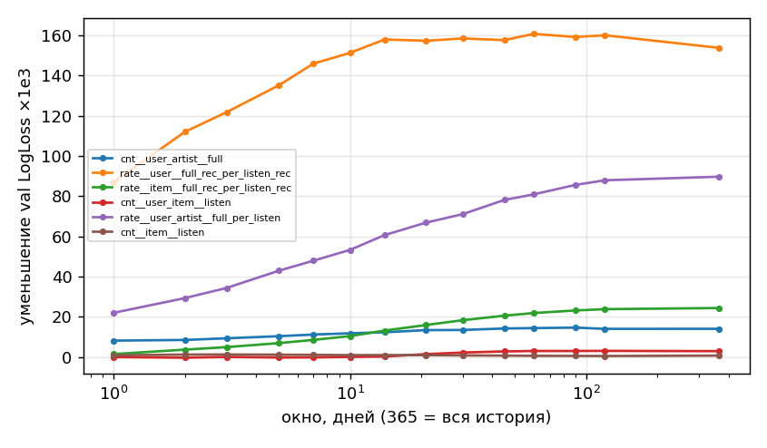
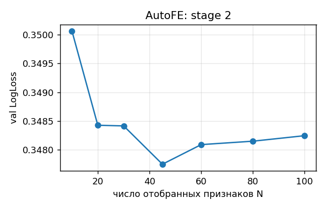

# AutoFE против ручных признаков: ранжирование рекомендаций на Yandex Yambda

Можно ли автоматизировать построение признаков для градиентного бустинга в рекомендательной системе и не потерять в качестве? В работе построен воспроизводимый пайплайн без утечек с сильным ручным бейзлайном и предложен **AutoFE**: поиск по грамматике признаков «сущность × статистика × масштаб времени» с отбором на валидации. Подходы сравниваются при одинаковом сплите, кандидатах, информации и модели.

## TL;DR

* **Задача:** для каждого трека, который рекомендательная система поставила пользователю (`is_organic = 0`), предсказать, дослушает ли он трек хотя бы до 50%. Это реальные показы, поэтому генерация кандидатов и сэмплирование негативов не нужны. Ранжирование оценивается внутри групп «пользователь × день».
* **Данные:** Yambda-50M, 5000 случайных пользователей с полной историей (23,6 млн событий, 301 день); дополнительный прогон на 1000 пользователях.
* **Сильный бейзлайн:** 55 ручных агрегатов (окна 1/7/30 дней и вся история) + 8 сессионных признаков + контекст, XGBoost. На test: **AUC 0.909, GAUC 0.667, NDCG@10 0.781**.
* **AutoFE:** перебор около 2400 кандидатов за 3,7 минуты на 1000 пользователей. Найденный набор без повторного поиска перенесён на 5000 пользователей. Результат: **GAUC +0.0038 [+0.0009; +0.0064], NDCG@10 +0.0021 [+0.0005; +0.0037]** к ручному набору. Разница статистически значима (парный бутстрэп по пользователям), но мала.
* **Главный содержательный вывод:** поиск сам нашёл, что *состояние пользователя* живёт 3–30 дней, а *вкус к артисту/альбому/треку* — около 90 дней (после расширения сетки до 365 дней оптимум остался внутри неё). В 66% семейств экспоненциальное затухание лучше жёсткого окна. Случайные признаки из той же грамматики почти не уступают ручным: грамматика уже покрывает то, что придумал бы инженер.
* **Чего AutoFE не заменяет:** самый сильный сигнал даёт сессия (предыдущий трек дослушан или скипнут: P = 0.87 против 0.27). Ещё больше, чем смена признаков, даёт ранжирующая целевая функция: **NDCG@10 0.781 → 0.846**.

---

## 1. Данные и EDA

[Yambda](https://huggingface.co/datasets/yandex/yambda) — открытый датасет Яндекс Музыки. Используется `flat/50m/multi_event.parquet` (10 000 пользователей, события `listen / like / dislike / unlike / undislike`, `played_ratio_pct`, `is_organic`) и маппинги трек → артист/альбом. Таймстемпы заданы в секундах, лог покрывает 301 день.

Сэмплирование соответствует условию: случайные пользователи берутся **со всей своей историей**. Основной прогон идёт на 5000 пользователях, прогон для масштабируемости — на 1000. EDA: `scripts/eda.py`, результаты в [`results/eda/eda.md`](results/eda/eda.md).

| | 5000 пользователей |
|---|---|
| событий | 23,6 млн (прослушиваний 22,98 млн, лайков 438 тыс., дизлайков 44 тыс.) |
| треков / артистов | 650 тыс. / 104 тыс. |
| доля рекомендательных прослушиваний | 48% |
| медиана прослушиваний на пользователя | 3040 (10%: 269, 90%: 12 898) |


Наблюдения, повлиявшие на постановку и признаки:

1. **Таргет бимодален.** 27,5% прослушиваний ≤ 10% длины трека (мгновенный скип), 57% ≥ 95% (дослушан). Порог 50% разделяет моды, поэтому выбор порога почти не влияет на разметку. Доля дослушиваний у рекомендаций 0.68, у органики 0.58. Таргет стационарен во времени.
   
2. **Повторное потребление велико.** 59,5% рекомендованных треков пользователь уже слушал раньше (доля дослушиваний 0.70). Ещё 21% — новый трек знакомого артиста (0.66), 19% — совсем новый (0.63). Отсюда признаки по парам user × item (прямые связи) и user × artist/album (косвенные).
3. **Длинный хвост.** Топ-1% треков дают 43% прослушиваний, 36% треков прослушаны один раз. В test 1,7% строк — треки без истории в выборке.
4. **Сессия — сильнейший сигнал.** P(дослушает | предыдущий дослушан) = **0.87**, P(дослушает | предыдущий скипнут) = **0.27**, первый трек дня — 0.59. Есть и суточная сезонность.
   
5. **Пользователи сильно различаются.** Доля дослушиваний по пользователям: 10-й перцентиль 0.22, медиана 0.68, 90-й перцентиль 0.94. Значит, глобальный AUC в основном измеряет «кто слушает», поэтому основные метрики качества ранжирования здесь — **GAUC и NDCG внутри группы**.
6. **16,7% лайкнутых пар (user, track) не имеют прослушивания в логе.** Поэтому like/listen — не доля, и отношения требуют аккуратной обработки. Именно на этом падал первый прогон AutoFE: затухшее «лайки/прослушивания» давало значения порядка 10^60.

## 2. Протокол эксперимента

* **Объекты:** рекомендательные прослушивания (`listen`, `is_organic = 0`) в целевые дни. **Таргет:** `played_ratio_pct ≥ 50`. **Группа ранжирования:** (пользователь, день).
* **Сплит по времени** (последние дни лога): train 21 день [266–286] → val 7 дней [287–293] → test 7 дней [294–300]. Для 5000 пользователей это 1,0 млн / 349 тыс. / 348 тыс. строк, доля позитивов около 0.68.
* **Кандидаты:** реально показанные треки, одинаковые для всех моделей.
* **Метрики:** LogLoss, ROC-AUC (глобальные); GAUC (AUC внутри групп, взвешенный по размеру) и NDCG@10, Precision@10 (внутри групп, по группам с обоими классами).
* **Отбор признаков и гиперпараметров — только на val.** Test используется один раз для итоговой оценки. Значимость оценивается **парным бутстрэпом по пользователям** (1000 реплик, `scripts/bootstrap.py`).
* **Модель:** XGBoost (`hist`, GPU), lr 0.05, 63 листа, subsample/colsample 0.8, early stopping по val. Для всех наборов признаков гиперпараметры одинаковы. Есть бэкенд LightGBM для CPU.

### Почему нет утечек

* **Агрегатные признаки.** Признаки для строки дня *d* читают состояние строго на конец дня *d − 1*. Это обеспечено конструктивно: движок хранит для каждой сущности кумулятивные суммы по дням и ищет их через `searchsorted` по ключу `key·1024 + (d − 1)`. Событие из будущего или само целевое событие в признак попасть не может.
* **Сессионные признаки** используют только **прослушивания строго раньше** текущего (тот же 5-секундный бин исключён). В них сознательно нет лайков: лайк текущего трека может быть залогирован раньше его listen-события. Нет и «времени с предыдущего события»: если ts — конец прослушивания, этот промежуток почти равен длительности текущего прослушивания.
* **Тесты** (`tests/test_leakage.py`):
  1. значения движка сверяются с наивным пересчётом по событиям `day < d`;
  2. произвольная порча событий с `day ≥ d` (перемешивание треков, смена флагов, удаление) не меняет ни одного признака;
  3. удаление всех событий после текущего трека не меняет сессионные признаки;
  4. train < val < test по времени.

## 3. Бейзлайн: ручные признаки

`src/yrec/feature_sets.py::manual_features` — 55 признаков, как написал бы инженер. Окна 1/7/30 дней и вся история, счётчики, конверсии и recency:

* **пользователь:** число прослушиваний, доля дослушиваний рекомендаций (7/30/всё), доля лайков, дизлайков, ранних скипов, органики, давность, стаж;
* **трек:** популярность (1/7/30/всё), доля дослушиваний, лайков, дизлайков, органики, возраст, давность;
* **артист, альбом:** популярность, доля дослушиваний, лайков;
* **user × item** (прямые связи): сколько раз слушал, дослушивал, лайкал, дизлайкал, доля дослушиваний, давность;
* **user × artist, user × album** (косвенные связи): то же, плюс доля артиста в прослушиваниях пользователя.

Плюс **8 сессионных** признаков (доля прослушанного у предыдущего трека и среднее по трём последним, доли дослушиваний и скипов за день до текущего момента, номер трека за день, тот же ли артист) и **контекст** (час, день недели, длина трека).

## 4. Исследовательская идея: AutoFE по грамматике признаков

**Грамматика** (`src/yrec/features.py`, `feature_sets.py::search_space`). Признак = сущность × статистика или конверсия × масштаб времени:

* **7 сущностей:** user, item, artist, album, user×item, user×artist, user×album;
* **9 статистик:** listen, listen_org, listen_rec, full, full_rec, early_skip, ratio_sum, like, dislike;
* **7 конверсий:** full/listen, full_rec/listen_rec, early_skip/listen, like/listen, dislike/listen, ratio_sum/listen, listen_org/listen;
* **масштаб времени:** 15 жёстких окон (1, 2, 3, 5, 7, 10, 14, 21, 30, 45, 60, 90, 120, 180 дней, вся история) **или** 8 экспоненциальных затуханий с периодом полураспада 1, 3, 7, 14, 30, 90, 180, 365 дней;
* плюс доля пары в активности пользователя (`share`), давность и стаж.

Итого **2746 кандидатов в 156 семействах.** Семейство — это признак без масштаба времени.

**Грамматика сессии** (`features.py::session_grammar`, 86 кандидатов в 21 семействе). Масштаб здесь измеряется не днями, а числом последних событий:

* `sg__{day|any}__{stat}__k{k}` — среднее по последним *k* прослушиваниям (k = 1, 2, 3, 5, 10, 20, 50 или весь день), только в текущем дне или по всей истории. Статистики: доля дослушиваний, средняя доля прослушанного, доля ранних скипов, доля органики, доля дослушиваний среди рекомендаций;
* `sp__{artist|item}__…` — тот же артист или трек: сколько прослушиваний прошло с последнего такого, сколько их было сегодня и за всю историю, доля дослушиваний.

Сессионные кандидаты подчиняются тем же правилам против утечек, что и ручные: только прослушивания строго раньше текущего, без лайков и пауз. Это проверено тестом.

**Быстрый движок.** Дневные агрегаты по каждой сущности накапливаются один раз. Любое окно [d − w, d − 1] считается разностью двух кумулятивных сумм. Затухание считается через кумулятивную сумму `x·2^{day/h}` (сумма прошлого с весами `2^{-(d − day)/h}`). Расчёт любого признака для 1 млн строк занимает доли секунды, и перебор тысяч признаков становится дешёвым.

**Поиск** (`src/yrec/autofe.py`), только на train/val:

1. **Масштаб времени внутри семейства.** Каждый вариант кодируется средним таргетом по квантильным бинам на train-выборке, затем оценивается уменьшение LogLoss на val. Остаются 2 лучших варианта на семейство с корреляцией < 0.97 между ними. Так из данных получается ответ на вопрос «почему 7 дней, а не 10».
2. **Отбор моделью.** Бустинг обучается на всех выживших признаках (около 250–280) вместе с фиксированными блоками. Признаки ранжируются по gain, число N выбирается по val LogLoss из {10, 20, …, 100}.

Запускаются два поиска:

* **AutoFE** — только агрегаты, ручные сессионные признаки и контекст зафиксированы. Выбрано N = 45.
* **AutoFE-full** — агрегаты и грамматика сессии ищутся вместе, зафиксирован только контекст (час, день недели, длина трека). Ни одного признака не написано вручную. Выбрано N = 100: 77 агрегатов и 23 сессионных признака. На эти 23 признака приходится 79% gain модели.

**Перенос.** Поиск выполняется на 1000 пользователях, найденный набор без изменений применяется на 5000. Это экономит время и память и заодно проверяет, что найденные признаки обобщаются.

**Контрольные эксперименты** (все с сессией и контекстом):

* `random_sameN` — 55 случайных признаков из той же грамматики: ценна ли сама грамматика без поиска;
* `manual_retuned_windows` — ручные признаки, у которых AutoFE заменил только окно на лучший масштаб;
* `autofe_sameN` — топ-55 AutoFE: сравнение при равном числе признаков;
* `manual∪autofe` — объединение;
* `autofe_full+sess` — AutoFE-full плюс ручные сессионные признаки;
* `*_lambdarank` — ранжирующая целевая функция вместо логлосса.

## 5. Результаты

### Основной прогон: 5000 пользователей, test (348 тыс. строк, 7356 групп)

| модель | признаков | LogLoss ↓ | AUC | GAUC | NDCG@10 |
|---|---:|---:|---:|---:|---:|
| доля дослушиваний трека (без обучения) | 1 | 0.7318 | 0.6462 | 0.5437 | 0.7269 |
| доля дослушиваний пользователя (без обучения) | 1 | 0.4752 | 0.8136 | 0.5000 | 0.7175 |
| только контекст | 3 | 0.6073 | 0.5681 | 0.5433 | 0.7351 |
| ручные | 58 | 0.4410 | 0.8389 | 0.5912 | 0.7715 |
| AutoFE | 63 | 0.4415 | 0.8384 | 0.5942 | 0.7710 |
| **ручные + сессия (бейзлайн)** | 66 | 0.3427 | 0.9093 | 0.6668 | 0.7805 |
| случайные N + сессия | 66 | 0.3434 | 0.9089 | 0.6658 | 0.7796 |
| ручные с подобранными окнами + сессия | 48 | 0.3433 | 0.9090 | 0.6636 | 0.7778 |
| **AutoFE + сессия** | 71 | 0.3426 | 0.9094 | **0.6705** | 0.7826 |
| AutoFE топ-N + сессия | 66 | 0.3425 | 0.9095 | 0.6695 | 0.7818 |
| ручные ∪ AutoFE + сессия | 124 | **0.3421** | **0.9097** | 0.6691 | **0.7840** |
| ручные + сессия, lambdarank | 66 | — | — | 0.7173 | 0.8461 |
| **AutoFE + сессия, lambdarank** | 71 | — | — | **0.7178** | **0.8466** |

У lambdarank предсказания — неоткалиброванные скоры, поэтому LogLoss и глобальный AUC для неё не имеют смысла.

**Разница с бейзлайном «ручные + сессия»** и 95% доверительный интервал (парный бутстрэп по пользователям, 1000 реплик):

| модель | GAUC | NDCG@10 | LogLoss |
|---|---|---|---|
| AutoFE + сессия | **+0.0038 [+0.0009, +0.0064]** | **+0.0021 [+0.0005, +0.0037]** | −0.0002 [−0.0006, +0.0002] |
| AutoFE топ-N + сессия | +0.0027 [+0.0003, +0.0049] | +0.0012 [−0.0004, +0.0028] | −0.0003 [−0.0006, +0.0001] |
| ручные ∪ AutoFE + сессия | +0.0024 [+0.0002, +0.0044] | **+0.0035 [+0.0019, +0.0049]** | **−0.0006 [−0.0009, −0.0003]** |
| случайные N + сессия | −0.0009 [−0.0035, +0.0013] | −0.0009 [−0.0028, +0.0009] | +0.0007 [+0.0002, +0.0012] |
| ручные с подобранными окнами + сессия | −0.0031 [−0.0053, −0.0011] | −0.0027 [−0.0043, −0.0011] | +0.0005 [+0.0002, +0.0009] |
| ручные + сессия, lambdarank | +0.0506 [+0.0434, +0.0578] | +0.0656 [+0.0622, +0.0687] | — |
| AutoFE + сессия, lambdarank | +0.0510 [+0.0441, +0.0584] | +0.0661 [+0.0629, +0.0697] | — |

### Прогон на 1000 пользователях (здесь выполнялись оба поиска), test 72 тыс. строк

| модель | признаков | LogLoss | AUC | GAUC | NDCG@10 | Δ GAUC [95% ДИ] | Δ NDCG@10 [95% ДИ] |
|---|---:|---:|---:|---:|---:|---|---|
| ручные (без сессии) | 58 | 0.4507 | 0.8379 | 0.5761 | 0.7572 | −0.0831 | −0.0147 |
| **ручные + сессия (бейзлайн)** | 66 | 0.3469 | 0.9101 | 0.6592 | 0.7719 | — | — |
| случайные N + сессия | 66 | 0.3463 | 0.9104 | 0.6570 | 0.7712 | −0.0022 [−0.0074, +0.0026] | −0.0006 [−0.0046, +0.0033] |
| ручные с подобранными окнами + сессия | 48 | 0.3460 | 0.9106 | 0.6613 | 0.7750 | +0.0020 [−0.0016, +0.0059] | +0.0031 [−0.0001, +0.0066] |
| AutoFE + сессия | 56 | 0.3458 | 0.9108 | 0.6616 | 0.7744 | +0.0024 [−0.0021, +0.0067] | +0.0025 [−0.0014, +0.0062] |
| AutoFE топ-N + сессия | 66 | 0.3458 | 0.9107 | 0.6595 | 0.7755 | +0.0003 [−0.0040, +0.0045] | +0.0036 [−0.0004, +0.0080] |
| ручные ∪ AutoFE + сессия | 110 | 0.3455 | 0.9109 | 0.6633 | 0.7760 | +0.0041 [+0.0003, +0.0084] | +0.0042 [+0.0004, +0.0076] |
| **AutoFE-full (без ручных признаков вообще)** | 103 | 0.3535 | 0.9063 | 0.6511 | 0.7589 | −0.0082 [−0.0155, −0.0012] | −0.0130 [−0.0191, −0.0062] |
| **AutoFE-full + ручная сессия** | 111 | **0.3412** | **0.9134** | **0.6716** | **0.7789** | **+0.0123 [+0.0072, +0.0178]** | **+0.0071 [+0.0024, +0.0124]** |
| ручные + сессия, lambdarank | 66 | — | — | 0.7016 | 0.8287 | +0.0423 | +0.0568 |
| AutoFE + сессия, lambdarank | 56 | — | — | 0.7050 | 0.8312 | +0.0457 | +0.0593 |
| AutoFE-full, lambdarank | 103 | — | — | 0.6651 | 0.7938 | +0.0059 | +0.0219 |

### AutoFE-full: можно ли обойтись совсем без ручных признаков

* **Почти, но не полностью.** Полностью автоматический набор (только контекст задан вручную) восстанавливает большую часть сессионного сигнала: GAUC растёт с 0.576 (агрегаты без сессии) до 0.651. При этом он всё же уступает ручному бейзлайну: −0.008 GAUC и −0.013 NDCG, разница значима.
* **Чего не хватает.** Поиск выбирает в каждом семействе масштаб по одномерному критерию. Для доли прослушанного лучшее одиночное окно — последние 5 треков (gain 0.246), а «последний трек» (k = 1, gain 0.205) отсеивается как сильно коррелированный. Но в модели именно предыдущий трек — самый важный признак ручного набора (47% gain). Короткая и длинная история *дополняют* друг друга (мгновенный импульс и текущее состояние), а одномерный отбор этого не видит.
* **Вместе — лучший результат всей работы.** AutoFE-full + ручная сессия: **GAUC +0.012 [+0.007; +0.018], NDCG +0.007, LogLoss −0.006** к бейзлайну. Это в 3–5 раз больше прироста от агрегатов. Найденные сессионные признаки добавляют то, чего нет в ручных:
  * историю длиннее дня (`sg__any__*`: последние 5–20 треков, в том числе вчерашних);
  * долю дослушиваний именно среди рекомендаций (`frec`);
  * «сколько треков назад был этот же трек» (`sp__item__gap`);
  * долю дослушиваний этого артиста по всей истории до текущего момента (`sp__artist__any_full`).
* **Масштабы сессии.** Оптимум по одиночному признаку — 5–10 последних прослушиваний для доли прослушанного и доли дослушиваний, 10–20 для ранних скипов. Из пар сильнее всего доля дослушиваний этого артиста (gain 0.097). Счётчики почти бесполезны (< 0.003).

Полные таблицы: [`results/report/tables.md`](results/report/tables.md).

### Какие масштабы времени выбрал поиск



*Уменьшение val LogLoss одиночным признаком в зависимости от окна* (1000 пользователей). Для доли дослушиваний пользователя качество растёт до 14 дней и дальше выходит на плато. Для доли дослушиваний артиста у этого пользователя качество растёт вплоть до всей истории.

| сущность | лучший масштаб (типично) | пример лучшего варианта семейства |
|---|---|---|
| пользователь (поведение) | затухание, полураспад 3–30 дней | `drate__user__full_rec_per_listen_rec__h30`, `…early_skip…__h14`, `dcnt__user__early_skip__h7` |
| пользователь × артист / альбом / трек | затухание, полураспад 90 дней | `drate__user_artist__full_rec_per_listen_rec__h90` |
| трек / артист / альбом | 30–90 дней | `drate__item__full_rec_per_listen_rec__h90` |

* Затухание лучше жёсткого окна в **66%** из 112 семейств счётчиков и конверсий.
* После расширения сетки (затухание до 365 дней, окна до 180) для пар user × artist/album/item по-прежнему чаще всего выигрывает период полураспада 90 дней: оптимум внутри сетки, а не на её границе. Год выбирается только для «черт» пользователя: доли органики и доли дизлайков.
* Сила сигнала по сущностям (лучший одиночный признак): user 0.168 > user×artist 0.096 > user×album 0.065 > user×item 0.052 > album 0.029 ≈ artist 0.028 > item 0.025.



Второй этап поиска: val LogLoss перестаёт улучшаться после 45–60 признаков.

### Вычислительные затраты (Colab T4: 2 vCPU, 12 ГБ RAM)

| этап | 1000 пользователей | 5000 пользователей |
|---|---:|---:|
| загрузка | 16 с | 23 с |
| индекс признаков (кумулятивные суммы) | 8 с | 48 с |
| ручные признаки (train + val + test) | 4 с | 29 с |
| **поиск AutoFE (2401 кандидат)** | **224 с** (этап 1: 169, этап 2: 54) | 0 (перенос) |
| признаки AutoFE (train + val + test) | 9 с | 74 с |
| обучение одной модели XGBoost на GPU | 5–6 с | 23–25 с |
| пиковая память процесса | 4,8 ГБ | 9,8 ГБ |

По скорости AutoFE обходится примерно в 50 раз дороже, чем посчитать ручной набор. В абсолютных цифрах это всего несколько минут: на порядки дешевле времени инженера. Время и память растут почти линейно по числу событий. Узкое место — память: полный поиск AutoFE на 5000 пользователях не влез в 12 ГБ, поэтому поиск сделан на подвыборке с переносом.

## 6. Анализ

**Что сработало**

* **Автоматический подбор масштаба времени.** Поиск воспроизвёл интуицию, которую инженер вносил бы вручную: короткая память для состояния пользователя, длинная для вкусов. Но получил её из данных и с более точными числами (затухание с полураспадом 3/14/30/90 дней вместо 7/30). Прирост к сильному бейзлайну мал (+0.004 GAUC, +0.002 NDCG), но значим на 5000 пользователях и **переносится** с подвыборки в 1000 пользователей, где делался поиск.
* **Грамматика как пространство признаков.** Даже *случайные* 55 признаков из грамматики дают качество на уровне ручных (разница в пределах шума). Ручной набор фактически был одной точкой этого пространства, и поиск находит в нём точки чуть лучше.
* **Объединение** ручных и AutoFE даёт лучший LogLoss и NDCG@10. Признаки частично дополняют друг друга, и бустинг устойчив к избыточности.

**Что не сработало или сработало слабо**

* **Подбор только окон у ручных признаков** (`manual_retuned_windows`) помог на 1000 пользователях, но на 5000 оказался **хуже** бейзлайна: −0.003 GAUC, значимо. Окно для каждого признака выбиралось по одномерному критерию и без учёта избыточности: в отобранном наборе 48 признаков вместо 55, потому что часть семейств схлопнулась в одинаковые признаки. Этого не хватает, когда признаки работают вместе. Отбор с учётом модели (этап 2) здесь важен.
* **Без сессии AutoFE не лучше ручного по NDCG** (по GAUC +0.003). Межсессионные агрегаты — вторичный сигнал, их прирост упирается в шум.
* **Потолок задают не агрегаты.** Около 80% gain в обеих моделях приходится на сессионные признаки. Переход к ранжирующей целевой функции даёт +0.05 GAUC и +0.066 NDCG — на порядок больше, чем любой выбор признаков. При lambdarank AutoFE добавляет к ручному набору лишь +0.0005 NDCG.

**Почему прирост мал.** Сильный бейзлайн уже содержит главные семейства (пользователь, user×artist, сессия). Выбор окна меняет признак плавно: профили на графике выше пологие после 10–14 дней. В этой задаче таргет в основном определяется поведением пользователя, а не сложными связями, и хорошая грамматика быстро насыщается.

## 7. Ограничения и что дальше

* Использована половина пользователей Yambda-50M (5000 из 10 000), test — 7 дней. Поиск сделан на 1000 пользователях из-за памяти Colab.
* Одномерный выбор масштаба внутри семейства отбрасывает *дополняющие* масштабы. Например, «последний трек» проигрывает «последним 5» поодиночке, но нужен модели вместе с ними. Из-за этого AutoFE-full без ручной сессии уступает бейзлайну. Лечится отбором с учётом модели на первом этапе (forward selection по семействам) или сохранением коротких масштабов принудительно.
* Контекст (час, день недели, длина трека) задан вручную и в поиск не входит.
* Гиперпараметры бустинга не подбирались отдельно под каждый набор, у всех наборов одинаковые настройки. Это честно для сравнения, но абсолютный максимум каждого подхода может быть выше.
* Поиск жадный и двухэтапный. Перспективные развития:
  * **LLM-агент**, который предлагает новые *типы* признаков (а не только масштабы) в виде SQL или DSL и получает обратную связь по val;
  * **дифференцируемый масштаб времени**: обучаемый период полураспада;
  * **модель над историей событий** (трансформер по последним N прослушиваниям с запросом «user × track»). Тот же движок кумулятивных сумм можно использовать для сжатия длинной истории в агрегаты.

## 8. Воспроизведение

```bash
pip install -r requirements.txt
make test                                    # тесты на утечки (~15 с); весь пайплайн: make all
make smoke                                   # весь пайплайн на синтетике (~30 с)
python scripts/eda.py --n-users 5000 --out results/eda
python scripts/run_experiments.py --n-users 1000 --out results/u1000                 # с поиском AutoFE
python scripts/run_experiments.py --n-users 5000 --autofe-from results/u1000 --out results/u5000
python scripts/bootstrap.py results/u1000 && python scripts/bootstrap.py results/u5000
python scripts/make_report.py results
```

* Для GPU добавьте `--backend xgb --device cuda`.
* Датасет скачивается с HuggingFace автоматически.
* Готовые ноутбуки: `notebooks/colab_run.ipynb` (Colab, T4, именно им получены результаты выше), `notebooks/local_run.ipynb` (CPU), `notebooks/kaggle_run.ipynb`.
* Пользователи выбираются `numpy.random.default_rng(0)` из всех `uid` (тот же seed — те же пользователи).

### Структура

```
src/yrec/data.py          загрузка Yambda, сэмплинг пользователей с полной историей, синтетика для тестов
src/yrec/protocol.py      таргет, временной сплит, метрики (LogLoss, AUC, GAUC, NDCG@10, P@10)
src/yrec/features.py      движок агрегатов без утечек (кумулятивные суммы + searchsorted), сессия, контекст
src/yrec/feature_sets.py  ручной набор и пространство поиска AutoFE
src/yrec/autofe.py        двухэтапный поиск AutoFE
src/yrec/model.py         XGBoost (GPU) / LightGBM / sklearn с одинаковыми гиперпараметрами
scripts/                  run_experiments.py, eda.py, bootstrap.py, make_report.py
tests/test_leakage.py     тесты на утечки
results/                  метрики, важности, профили окон, бутстрэп, EDA
```
