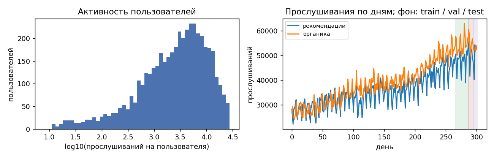
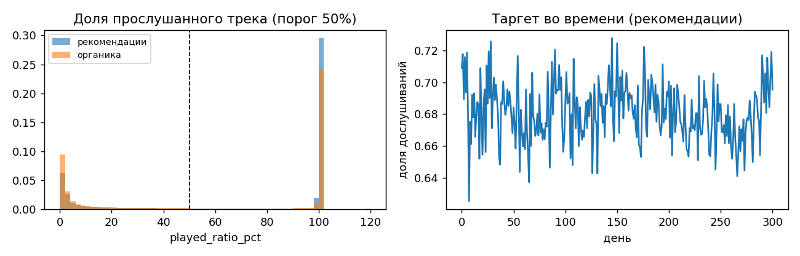
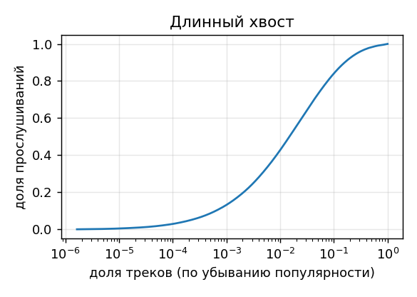
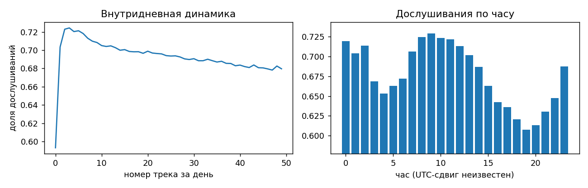
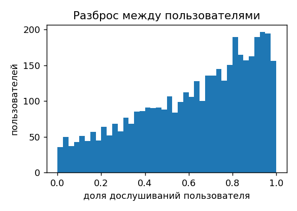

# EDA: Yambda-50M, 5000 случайных пользователей

## 1. Общая картина

|                                     |         значение |
|:------------------------------------|-----------------:|
| событий                             |      2.36369e+07 |
| пользователей                       |   5000           |
| треков                              | 649741           |
| артистов                            | 103925           |
| дней                                |    301           |
| доля рекомендательных прослушиваний |      0.48        |

|           |    число событий |
|:----------|-----------------:|
| listen    |      2.29845e+07 |
| like      | 437590           |
| dislike   |  44360           |
| unlike    | 160488           |
| undislike |  10003           |

## 2. Таргет

Распределение доли прослушанного бимодально: 27.5% прослушиваний ≤10% (мгновенный скип), 57.1% ≥95% (дослушан). Порог 50% разделяет моды. Доля дослушиваний: рекомендации 0.681, органика 0.585.

## 3. Повторное потребление и косвенные связи (рекомендательные прослушивания)

|                             |   доля строк |   доля дослушиваний |
|:----------------------------|-------------:|--------------------:|
| трек уже слушал             |        0.595 |               0.704 |
| новый трек, знакомый артист |        0.212 |               0.663 |
| новый трек, новый артист    |        0.193 |               0.628 |

В test 1.7% строк — треки, которых не было в истории этой выборки (холодные для item-признаков).

## 4. Популярность

Топ-1% треков дают 42.8% прослушиваний; 35.9% треков прослушаны ровно один раз.

## 5. Сессия

P(дослушает | предыдущий дослушан) = 0.873, P(дослушает | предыдущий скипнут) = 0.266, первый трек дня: 0.593. Состояние пользователя внутри дня — сильный сигнал.

## 6. Различия между пользователями и лайки

Доля дослушиваний у пользователей (≥20 рек. прослушиваний): 10% = 0.22, медиана = 0.68, 90% = 0.94 — большая часть глобального AUC объясняется «кто слушает», а не «что». 16.7% лайкнутых (user, track) не имеют прослушивания в логе — поэтому like/listen не является долей и требует аккуратной нормировки.
